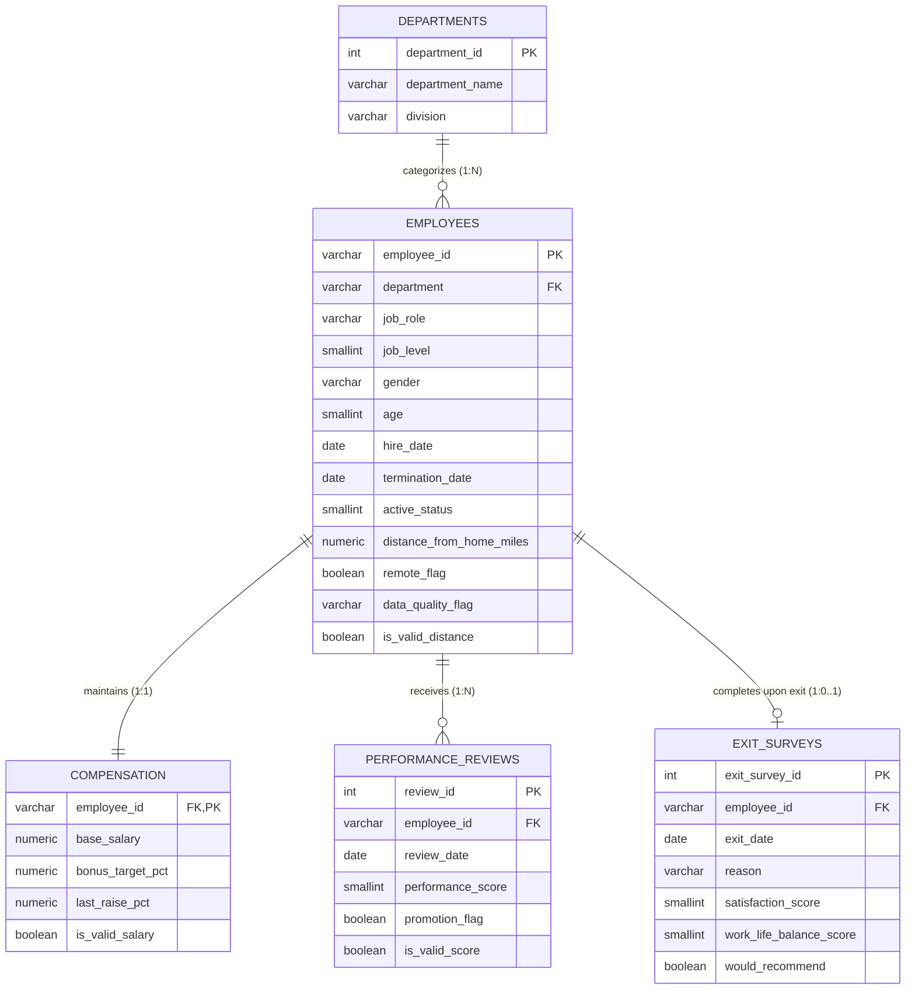
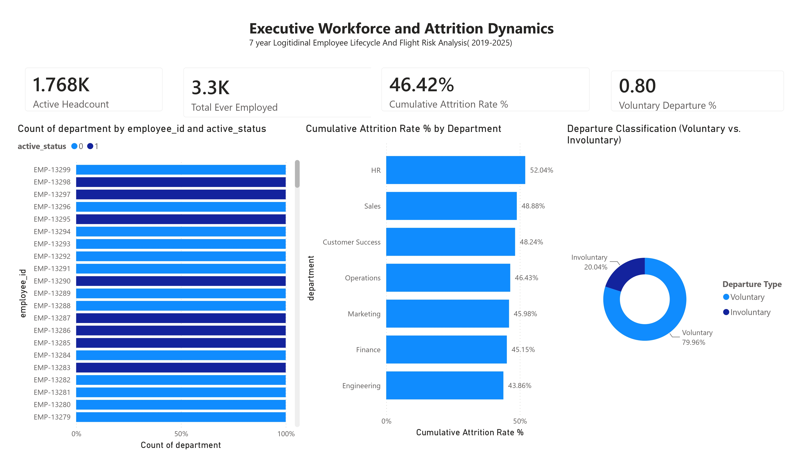
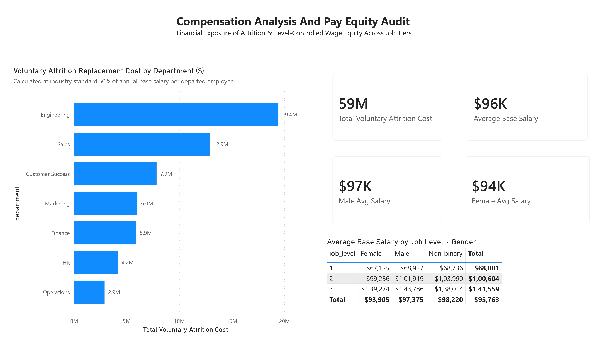
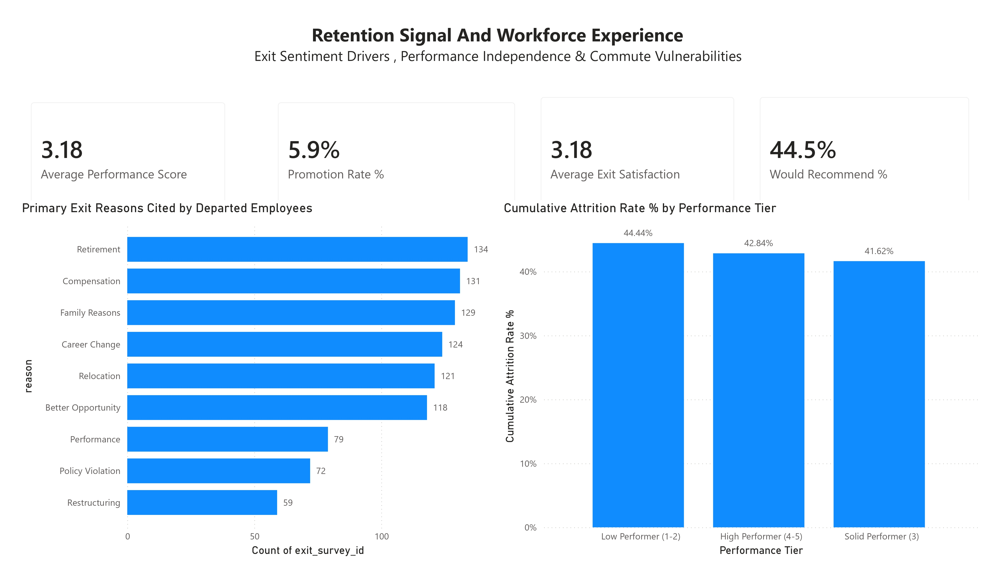

# HR People Analytics & Workforce Intelligence

---

## 1. Executive Summary & Business Motivation

Analyzing **7 years (2019–2025)** of employee lifecycle data across **3,300 personnel records** and **7 operating departments**. The pipeline bridges raw HRIS transactional records, automated data cleansing across 8 enterprise data quality defect categories, high-performance PostgreSQL 14+ analytical queries, cross-sectional attrition modeling with rigorous feature-importance stress testing, and an interactive **3-page Power BI executive report suite (`hr_people_analytics.pbix`)**.

```
========================================================================================
                                 HEADLINE BUSINESS METRICS
========================================================================================
Active Workforce (Dec 2025):     1,890 Employees (-13.9% YoY from 2024 peak of 2,195)
2025 Annualized Attrition:       22.52% (inflection point vs. 13–14% historical run rate)
Cumulative Historical Attrition: 46.65% (1,410 departures across 7 operating years)
Voluntary Departure Dominance:   80.0% of all departures (1,225 voluntary exits vs. 307 involuntary)
Voluntary Attrition Financial:   $59.2M replacement exposure ($19.4M concentrated in Eng)
Level-Controlled Gender Pay Gap: ~3.56% systemic female gap holding within EVERY job tier
Top-Performer Flight Risk:       43.2% high performers leave (vs. 39.6% low performers)
========================================================================================
```

---

## 2. Core Business Questions Addressed

1. **Longitudinal Headcount Dynamics:** Why did total workforce headcount contract for the first time in company history in 2025 (-13.9% YoY), and why did traditional cumulative attrition metrics fail to warn leadership?
2. **The Top-Performer Retention Fallacy:** Are high-performing personnel departing at disproportionate rates, and does performance-contingent retention spend address root exit drivers?
3. **Level-Controlled Gender Wage Equity:** Does the company-wide 3.56% gender pay gap reflect unequal representation across tiers (Simpson's Paradox), or does wage disparity persist within identical seniority levels?
4. **Financial Replacement Exposure:** How does turnover rate compare to absolute replacement dollar impact when prioritizing departmental retention budgets?
5. **Machine Learning Feature Rigor:** What factors truly predict flight risk once circular feature leakage (tenure duration) is empirically audited and isolated?

---

## 3. Data Quality & Cleansing Matrix (8 Documented Defects)

Real-world HRIS migrations introduce systemic data anomalies. Rather than ignoring or silently imputing invalid entries, 8 distinct defects were audited, cataloged with detection queries in [`sql/02_data_quality_checks.sql`](sql/02_data_quality_checks.sql), and programmatically handled:

| Defect # | Category | Anomaly Signature | Volume | Analytical Cleansing Rule | Business / Technical Rationale |
|---|---|---|---|---|---|
| **1** | Deduplication | Duplicate `employee_id` records | 47 rows | Deduplicated on primary key, retaining earliest entry | Resolves duplicate records created during HRIS migration. |
| **2** | Categorical Hygiene | Department casing/whitespace variants (`ENGINEERING`, ` Sales `) | 27 rows | Standardized via regex and trimmed to 7 canonical names | Eliminates splintered grouping in SQL `GROUP BY` and BI visuals. |
| **3** | Status-Sync Gap | Employees marked `active_status = 0` with NULL `termination_date` | 122 rows | Flagged `data_quality_flag = 'MISSING_TERM_DATE'`; excluded from tenure calc | Preserved in attrition denominators while preventing corrupted tenure distributions. |
| **4** | Logical Chronology | Inverted lifecycle dates (`hire_date` > `termination_date`) | 33 rows | Swapped timestamp columns back to chronological order | Restores chronological integrity for tenure tracking. |
| **5** | Spatial Domain | Negative or zero commute distance (`distance_from_home_miles` <= 0) | 58 rows | Flagged `is_valid_distance = FALSE` | Isolates invalid geocoding entries from spatial commute models. |
| **6** | Financial Audit | Zero or negative salary entries (`base_salary` <= 0) | 61 rows | Flagged `is_valid_salary = FALSE` | Excluded from compa-ratio calculations to prevent division errors. |
| **7** | Evaluation Range | Performance scores outside legitimate 1–5 review scale | 41 rows | Flagged `is_valid_score = FALSE` | Filters out validation bugs from HR review surveys. |
| **8** | Referential Integrity | Orphaned exit survey records referencing nonexistent `employee_id` | 24 rows | Purged records with missing foreign key references | Prevents unjoined records that distort exit survey analysis. |

---

## 4. PostgreSQL 14+ Relational Warehouse & Analytical Schema

The data warehouse architecture implements an employee-centric star schema within the dedicated `analytics` schema, enforcing primary and foreign key constraints, B-tree indexes, and optimized query execution paths. Detailed table dictionaries and storage specifications are documented in [`architecture/README.md`](architecture/README.md).



### Advanced SQL Analytical Query Highlights (`sql/03_business_analysis_queries.sql`)

| Query ID | Business Question & Analytical Focus | Key SQL Techniques Applied | Strategic Insight Uncovered |
|---|---|---|---|
| **Q1** | Year-End Headcount Trajectory | `generate_series`, `FILTER (WHERE ...)`, `CROSS JOIN` | 2019 (108) to peak 2024 (2,195), contracting to 2025 (1,890). |
| **Q2** | Annualized Attrition Rate by Year | CTEs, `EXTRACT(YEAR)`, `MAKE_DATE`, `COALESCE` | 13.26% (2021) surging to 22.52% (2025) inflection point. |
| **Q3** | Cumulative Attrition by Department | `COUNT(*) FILTER`, percentage ratios, `GROUP BY` | HR highest (52.04%), Engineering lowest (43.86%). |
| **Q8 & Q9** | Level-Controlled Gender Wage Equity | `FIRST_VALUE() OVER`, `PARTITION BY`, Window Diff | Female pay gap holds across Level 1 (-2.6%), 2 (-2.6%), 3 (-3.1%). |
| **Q12** | Performance Tier Attrition Independence | `DISTINCT ON (employee_id)`, conditional CASE binning | Top performers leave at 43.24% vs. low performers at 39.63%. |
| **Q17** | Financial Replacement Cost Exposure | `SUM(c.base_salary) * 0.5`, exclusion filters | Engineering accounts for $19.4M (32.8%) of $59.2M total cost. |

---

## 5. Key Strategic Findings & Analytical Diagnoses

### 1. Attrition Acceleration & First Historical Headcount Contraction
* **The Diagnostic Failure of Cumulative Metrics:** A cumulative attrition figure sits at 43.9%–52.0% across all departments, giving executive leadership the false impression of a stable baseline.
* **The Annualized Reality:** Evaluating year-by-year annualized rates reveals an acute inflection point:
  * 2021: **13.26%** (97 departures / 732 avg headcount)
  * 2022: **13.37%** (177 departures / 1,324 avg headcount)
  * 2023: **14.23%** (268 departures / 1,884 avg headcount)
  * 2024: **17.31%** (373 departures / 2,155 avg headcount)
  * **2025: 22.52%** (460 departures / 2,043 avg headcount)
* **Headcount Impact:** For the first time in company history, year-end headcount shrank from **2,195 (2024)** down to **1,890 (2025)** because departures completely outpaced talent acquisition.

### 2. The High-Performer Retention Fallacy
Most corporate retention budgets disproportionately target "top talent" retention bonuses under the assumption that high performers leave at higher rates. The empirical data disproves this hypothesis:
* **High Performers (Score 4–5):** **43.24%** cumulative attrition
* **Solid Performers (Score 3):** **43.57%** cumulative attrition
* **Low Performers (Score 1–2):** **39.63%** cumulative attrition
* **Executive Implication:** Retention programs built around performance-based retention bonuses fail to address root causes. Departures are driven by compensation competitiveness and workplace logistics rather than performance dissatisfaction.

### 3. Level-Controlled Pay Equity Audit (Simpson's Paradox Resolution)
Company-wide, female base salary averages **$93,905** compared to **$97,375** for male counterparts (a **3.56% gap**). Rather than being an artifact of female concentration in entry-level bands, a level-controlled matrix analysis confirms the wage disparity exists systematically across **every individual job level**:
* **Level 1 (Associate/Entry):** Male **$68,927** vs. Female **$67,125** (-2.6% gap)
* **Level 2 (Mid-Level/Senior):** Male **$101,919** vs. Female **$99,256** (-2.6% gap)
* **Level 3 (Lead/Staff):** Male **$143,786** vs. Female **$139,274** (-3.1% gap)

### 4. Financial Exposure: Rate vs. Absolute Dollar Impact
Using the industry standard 50% replacement cost rule (recruiting, onboarding ramp-up, lost productivity):
* **Engineering** carries the lowest historical attrition rate of all departments (**43.86%**), but accounts for the **largest financial replacement cost ($19.4M)** due to high headcount scale (1,165 personnel) and senior salary bands.
* **HR** carries the highest attrition rate (**52.04%**), but accounts for only **$4.2M** in financial impact.
* **Strategic Takeaway:** Target departmental retention policies by **rate** for organizational health and culture diagnostics, but allocate retention budgets by **dollar exposure**.

---

## 6. Machine Learning Model & Feature Rigor

A Random Forest attrition classifier was trained on 3,228 records across demographic, structural, compensation, and evaluation features:
* **Initial Headline Performance:** ROC-AUC **0.7208**, Overall Accuracy **68.4%**.
* **Feature Importance Breakdown:**
  * `tenure_years`: **53.32%**
  * `compa_ratio`: **12.47%**
  * `distance_from_home_miles`: **9.57%**
  * `age`: **7.69%**
  * `department`: **3.98%**
  * `performance_score`: **3.98%**
* **The Rigorous Stress Test (Data Leakage Audit):** Because departed employees inherently have fixed, truncated tenures while active employees continue accruing time, tenure is an endogenous proxy for the target variable. **Removing `tenure_years` drops model ROC-AUC to 0.55 (near random).**
* **Production Recommendation:** The model should inform organizational compensation competitiveness and remote work policies rather than automated, individual-level flight risk scoring.

---

## 7. Executive Power BI Visual Suite

The complete, interactive Power BI report suite is available as a binary model at [`dashboards/powerbi/hr_people_analytics.pbix`](dashboards/powerbi/hr_people_analytics.pbix), constructed with custom DAX measures, star-schema relational modeling, and executive layout formatting. Complete visual breakdowns and measures are documented in [`dashboards/README.md`](dashboards/README.md).

### Page 1: Executive Workforce & Attrition Dynamics
*Longitudinal headcount trajectory, department attrition benchmarks, and departure classification.*


### Page 2: Compensation Analysis & Pay Equity Audit
*Voluntary replacement cost exposure ($59.2M) and level-controlled wage equity across job tiers.*


### Page 3: Retention Signals & Workforce Experience
*Exit sentiment drivers, performance rating independence, and commute vulnerability indicators.*


---

**Ravikant Yadav**  
* [LinkedIn](https://linkedin.com/in/ravikant-yadav-39936a1a8)
* [GitHub Profile](https://github.com/ravi020410)
