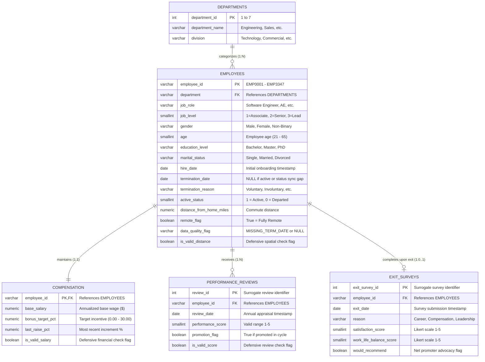

# Enterprise Architecture & Data Engineering Design

---

## Relational Schema Specifications & Data Dictionary

### Table 1: `analytics.departments` (Organizational Dimension)
* **Storage Engine:** PostgreSQL 14+ Relational Table  
* **Record Count:** 7 rows  
* **Primary Key:** `department_id`  

| Column Name | Data Type | Constraints | Nullable | Description & Domain Range |
|---|---|---|---|---|
| `department_id` | `INTEGER` | `PRIMARY KEY` | No | Unique department identifier (1 to 7). |
| `department_name` | `VARCHAR(50)` | `NOT NULL`, `UNIQUE` | No | Standardized departmental label (e.g., Engineering, Sales, Product). |
| `division` | `VARCHAR(50)` | `NOT NULL` | No | Higher-level organizational division (Technology, Commercial, Corporate). |

---

### Table 2: `analytics.employees` (Central Entity / Fact & Master Dimension)
* **Storage Engine:** PostgreSQL 14+ Relational Table  
* **Record Count:** 3,300 rows (curated from 3,347 raw via deduplication of 47 duplicate IDs)  
* **Primary Key:** `employee_id`  
* **Foreign Key:** `department` maps logically to `departments.department_name`  
* **Indexes:** B-tree on `department`, B-tree on `active_status`, B-tree on `(job_level, gender)`  

| Column Name | Data Type | Constraints | Nullable | Description & Domain Range |
|---|---|---|---|---|
| `employee_id` | `VARCHAR(20)` | `PRIMARY KEY` | No | Unique natural employee code (`EMP0001` to `EMP3347`). |
| `department` | `VARCHAR(50)` | `NOT NULL` | No | Cleansed department name matching `departments.department_name`. |
| `job_role` | `VARCHAR(50)` | `NOT NULL` | No | Functional title (e.g., Software Engineer, Account Executive, Data Analyst). |
| `job_level` | `SMALLINT` | `NOT NULL`, `CHECK (job_level BETWEEN 1 AND 3)` | No | Professional tier: 1 = Associate/Entry, 2 = Mid/Senior, 3 = Lead/Staff. |
| `gender` | `VARCHAR(20)` | `NOT NULL` | No | Self-reported gender identity (`Male`, `Female`, `Non-Binary`). |
| `age` | `SMALLINT` | `NOT NULL`, `CHECK (age BETWEEN 18 AND 75)` | No | Chronological age at ingestion baseline (21 to 65). |
| `education_level` | `VARCHAR(20)` | `NOT NULL` | No | Highest attained credential (`Bachelor`, `Master`, `PhD`). |
| `marital_status` | `VARCHAR(20)` | `NOT NULL` | No | Demographic status (`Single`, `Married`, `Divorced`). |
| `hire_date` | `DATE` | `NOT NULL` | No | Official organizational onboarding date (2019-01-01 to 2025-12-31). |
| `termination_date` | `DATE` | None | Yes | Official exit date. `NULL` for active staff or status-sync gap anomalies. |
| `termination_reason` | `VARCHAR(30)` | None | Yes | Exit category (`Career Growth`, `Compensation`, `Relocation`, `Retirement`, etc.). |
| `active_status` | `SMALLINT` | `NOT NULL`, `CHECK (active_status IN (0, 1))` | No | Workforce status: `1` = Active, `0` = Departed. |
| `distance_from_home_miles` | `NUMERIC(6,1)` | `NOT NULL` | No | Commute distance in miles between residence and workplace (0.1 to 65.0). |
| `remote_flag` | `BOOLEAN` | `NOT NULL` | No | Operational workplace mode: `TRUE` = Fully Remote, `FALSE` = On-Site/Hybrid. |
| `data_quality_flag` | `VARCHAR(30)` | None | Yes | Cleansing audit tag: `'MISSING_TERM_DATE'` for 122 status-sync gap rows. |
| `is_valid_distance` | `BOOLEAN` | `NOT NULL DEFAULT TRUE` | No | Defensive spatial validation flag (`FALSE` for 58 zero/negative mile inputs). |

---

### Table 3: `analytics.compensation` (Financial Dimension)
* **Storage Engine:** PostgreSQL 14+ Relational Table  
* **Record Count:** 3,347 rows (includes 61 defensive quality-flagged rows)  
* **Primary Key / Foreign Key:** `employee_id` references `employees(employee_id)`  
* **Indexes:** B-tree on `employee_id`, B-tree on `base_salary`  

| Column Name | Data Type | Constraints | Nullable | Description & Domain Range |
|---|---|---|---|---|
| `employee_id` | `VARCHAR(20)` | `PRIMARY KEY`, `REFERENCES analytics.employees(employee_id)` | No | Employee natural identifier. |
| `base_salary` | `NUMERIC(10,2)` | `NOT NULL` | No | Annual base compensation in USD ($42,000 to $195,000). |
| `bonus_target_pct` | `NUMERIC(5,2)` | `NOT NULL` | No | Contractual annual incentive bonus percentage (5.00% to 30.00%). |
| `last_raise_pct` | `NUMERIC(5,2)` | `NOT NULL` | No | Merit salary adjustment percentage received in latest cycle (0.00% to 15.00%). |
| `is_valid_salary` | `BOOLEAN` | `NOT NULL DEFAULT TRUE` | No | Defensive audit flag (`FALSE` for 61 zero/negative entries). |

---

### Table 4: `analytics.performance_reviews` (Longitudinal Evaluation Fact)
* **Storage Engine:** PostgreSQL 14+ Relational Table  
* **Record Count:** 8,391 rows spanning annual evaluation cycles (2019–2025)  
* **Primary Key:** `review_id`  
* **Foreign Key:** `employee_id` references `employees(employee_id)`  
* **Indexes:** B-tree on `employee_id`, B-tree on `review_date`, B-tree on `(employee_id, review_date)`  

| Column Name | Data Type | Constraints | Nullable | Description & Domain Range |
|---|---|---|---|---|
| `review_id` | `INTEGER` | `PRIMARY KEY` | No | Unique surrogate review transaction identifier. |
| `employee_id` | `VARCHAR(20)` | `NOT NULL`, `REFERENCES analytics.employees(employee_id)` | No | Target employee being evaluated. |
| `review_date` | `DATE` | `NOT NULL` | No | Formal evaluation sign-off timestamp. |
| `performance_score` | `SMALLINT` | `NOT NULL` | No | Performance rating: 1 = Unsatisfactory, 3 = Meets Expectations, 5 = Exceeds. |
| `promotion_flag` | `BOOLEAN` | `NOT NULL` | No | Advancement flag: `TRUE` indicates title/level advancement in this review cycle. |
| `is_valid_score` | `BOOLEAN` | `NOT NULL DEFAULT TRUE` | No | Defensive rating audit flag (`FALSE` for 41 scores outside 1–5 range). |

---

### Table 5: `analytics.exit_surveys` (Departure Feedback Dimension)
* **Storage Engine:** PostgreSQL 14+ Relational Table  
* **Record Count:** 967 rows (curated from 991 raw via purging of 24 orphan records)  
* **Primary Key:** `exit_survey_id`  
* **Foreign Key:** `employee_id` references `employees(employee_id)`  
* **Indexes:** B-tree on `employee_id`, B-tree on `reason`  

| Column Name | Data Type | Constraints | Nullable | Description & Domain Range |
|---|---|---|---|---|
| `exit_survey_id` | `INTEGER` | `PRIMARY KEY` | No | Unique surrogate exit survey submission identifier. |
| `employee_id` | `VARCHAR(20)` | `NOT NULL`, `REFERENCES analytics.employees(employee_id)` | No | Departed employee identifier. |
| `exit_date` | `DATE` | `NOT NULL` | No | Exit interview completion timestamp. |
| `reason` | `VARCHAR(30)` | `NOT NULL` | No | Primary stated motivation for departure (Career, Compensation, Culture, Commute). |
| `satisfaction_score` | `SMALLINT` | `NOT NULL`, `CHECK (satisfaction_score BETWEEN 1 AND 5)` | No | Overall organizational satisfaction rating (1 = Very Dissatisfied, 5 = Highly Satisfied). |
| `work_life_balance_score` | `SMALLINT` | `NOT NULL`, `CHECK (work_life_balance_score BETWEEN 1 AND 5)` | No | Work-life equilibrium rating (1 = Poor, 5 = Excellent). |
| `would_recommend` | `BOOLEAN` | `NOT NULL` | No | Employer Net Promoter advocacy question: `TRUE` = Would recommend to peers. |

---

