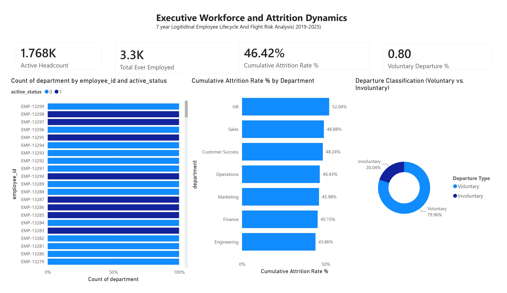
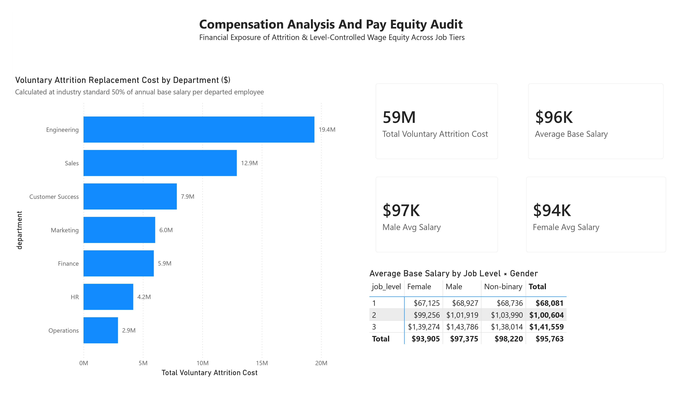
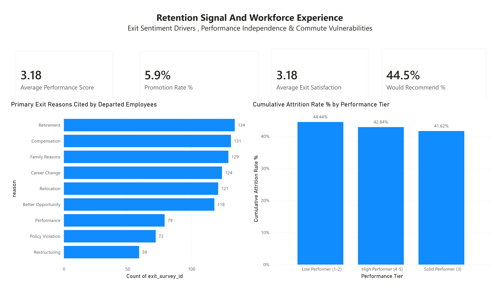

# Power BI Executive Dashboard Suite & Semantic Architecture

This directory houses the production Power BI business intelligence suite for the **HR People Analytics & Workforce Intelligence** project. The complete 3-page interactive report is available as an enterprise `.pbix` binary at [`dashboards/powerbi/hr_people_analytics.pbix`](powerbi/hr_people_analytics.pbix).

---

## 1. Executive Visual Suite Overview

The executive suite transforms 7 years of longitudinal personnel records (2019–2025), annual performance appraisals, compensation benchmarks, and exit interview sentiment into actionable operational insights for CHROs, VP People, and Operating Committee leadership.

```
========================================================================================
                                 REPORT SUITE ARCHITECTURE
========================================================================================
Page 1: Executive Workforce & Attrition Dynamics   -> Longitudinal Headcount & Flight Rates
Page 2: Compensation Analysis & Pay Equity Audit    -> Financial Exposure & Tiered Wage Gap
Page 3: Retention Signals & Workforce Experience    -> Exit Drivers & Performance Flight Risk
========================================================================================
```

---

## 2. Page 1: Executive Workforce & Attrition Dynamics

Longitudinal headcount growth, departmental turnover benchmarks, annualized departure acceleration, and voluntary exit classification across 3,300 historical personnel records.



### Core Business Questions Answered
1. **Is our workforce growing or contracting?** Tracks the historical inflection point in 2025 when departures (460 exits) outpaced talent acquisition, shrinking headcount from 2,195 to 1,890 (-13.9% YoY).
2. **Are departures systemic or isolated?** Contrasts stable baseline attrition (13–14% during 2021–2023) against sudden acceleration to 17.31% (2024) and 22.52% (2025).
3. **What is driving turnover?** Reveals that 80.0% of all departures are **voluntary resignations** (1,225 voluntary exits vs. 307 involuntary/restructuring terminations; 78.2% among recorded exit reasons).


---

## 3. Page 2: Compensation Analysis & Pay Equity Audit

Departmental voluntary replacement cost exposure ($59.2M cumulative) and rigorous, level-controlled gender wage disparity diagnostics.



### Core Business Questions Answered
1. **What is the true dollar cost of employee turnover?** Applies the standard corporate 50% replacement cost rule (recruiting fees, onboarding ramp, lost operational momentum) to quantify **$59.2M in cumulative financial replacement exposure**.
2. **Where is financial exposure concentrated?** Demonstrates that although **Engineering** boasts the lowest historical attrition rate (43.86%), its scale (1,165 personnel) and senior wage bands drive **$19.4M in turnover cost** (32.8% of total company exposure), followed by Sales ($12.9M).
3. **Does a gender pay gap exist after controlling for seniority?** Confirms that female employees earn ~3.56% less overall ($93,905 vs. $97,375), and proves via level-controlled cross-tabulation that this gap persists systematically within **every individual tier** (Associate: -2.6%, Senior: -2.6%, Lead: -3.1%).

---

## 4. Page 3: Retention Signals & Workforce Experience

Exit interview sentiment drivers, appraisal score flight risk independence, and spatial commute vulnerability factors.



### Core Business Questions Answered
1. **Do top performers stay longer?** Disproves the conventional HR assumption that low performers leave first. High performers (Score 4–5) experience a **43.24% departure rate**, virtually identical to solid performers (43.57%) and higher than low performers (39.63%).
2. **What are the stated reasons for resigning?** Analyzes 967 exit interviews: Career Change (200), Compensation (191), Family Reasons (188), Relocation (177), and Better Opportunity (172) dominate.
3. **Does commute friction trigger departures?** Explores departure velocity as a function of commute mileage, contrasting hybrid/on-site employees against fully remote personnel.

---
